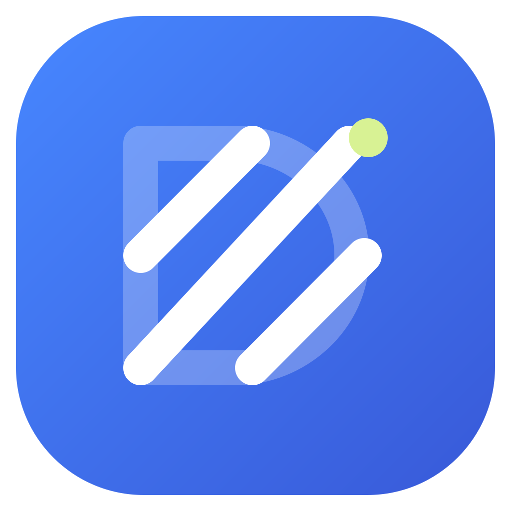
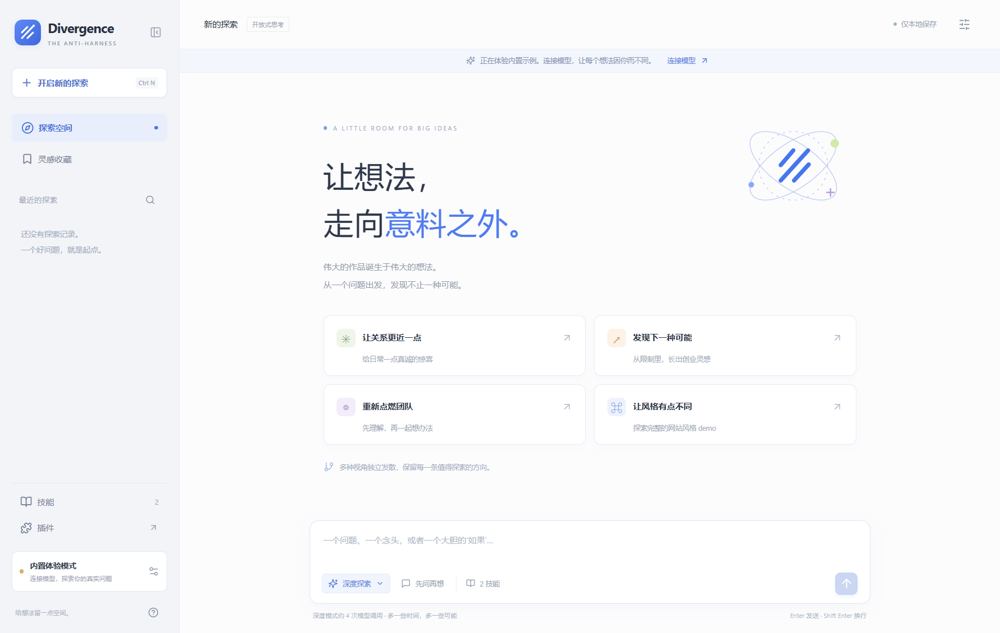

<div align="center">
  
  <h1>Divergence</h1>
  <p><strong>伟大的作品诞生于伟大的想法。</strong></p>
  <p>A little room for big ideas. The desktop anti-harness.</p>
  <p><a href="https://github.com/Antzer404/divergence/releases/latest">下载桌面版</a> · <a href="docs/RESEARCH.md">创造力研究</a> · <a href="docs/EXTENSIONS.md">扩展指南</a></p>
</div>

常见 Agent 帮你把任务收敛到完成。Divergence 帮你打开更多可能：多种视角独立发散、跨界重组，每条方向都附带第一步和最小验证实验，把选择权留给你。



**v1.0.0 正式版**：Windows、Apple Silicon Mac 与 Intel Mac 已通过用户验收。提供完整的创意发散、技能与插件扩展、离线可用的 Noto Sans SC / Inter 可变字体，以及柔和动效、聊天框指针反馈与自动增高。支持键盘导航及系统减少动态效果偏好。

## 下载安装

只通过 [GitHub Releases](https://github.com/Antzer404/divergence/releases) 分发。

- **Windows 10/11 x64**：下载 `.exe` 一键安装并创建桌面快捷方式；或下载 `.zip` 解压后双击 `Divergence.exe`。无需安装 Node.js。
- **macOS / Apple Silicon（M 系列）**：下载 `mac-arm64.dmg`，打开后把 Divergence 拖入 Applications。
- **macOS / Intel**：下载 `mac-x64.dmg`。两个架构均提供 ZIP 备用包。应用不需要另装 Node.js，详见 [MacBook 安装说明](docs/MACOS_ACCEPTANCE.md)。
- 首次打开是明确标注的**内置体验模式**，使用固定示例，便于零配置体验。
- 打开「偏好设置 → 模型连接」，关闭体验模式，填写兼容 OpenAI Chat Completions 的 API 地址、模型 ID 和 Key，测试后保存。DeepSeek 与本地 Ollama 有快捷预设；本地模型可不填 Key，模型需要先自行下载并运行。

DeepSeek 快捷预设使用官方当前的 `deepseek-flash`，默认关闭思考模式以保留温度采样控制；可填写其他模型 ID。参见 [DeepSeek 官方接入文档](https://api-docs.deepseek.com/)。
- 更新时使用「关于与更新 → 检查 GitHub 更新」，手动下载新版安装。会话存放在用户数据目录，更新安装程序不会主动删除它。

Windows 安装包未购买代码签名证书，系统可能显示未知发布者。macOS 使用 ad-hoc 签名，保留 Hardened Runtime，尚未获得 Apple Developer ID 签名与 Apple 公证，首次打开可能需要按系统提示手动批准。Linux 目前仅有构建配置，以 Release 实际附件为准。

## 可以怎样用

> 如何哄女朋友开心？预算100元，今晚就想做点真诚、有新意的小事。

> 给一些大学生创业项目参考。预算5000元，团队3人，比赛要求一个月内完成用户验证……

> 我是一名公司高管，团队最近没有工作热情。先问我几个问题，再一起寻找不同方向。

> 我想做个人网站。给我三个截然不同的完整风格预设，每个都提供可预览的 HTML demo。

- **深度探索**：三个独立模型请求分别从人、反转与跨界视角探索，再调用一次模型产生跨方向组合；保留原始候选，不评选唯一赢家。约4次调用，工具与格式修复可能增加调用。
- **快速发散**：一次请求提出多个不同方向，适合快速启发。
- **先问再想**：这一轮只问1–3个关键背景问题，回答后继续发散。
- **继续发散**：从任意点子分支，生成不同变体；也可要求避开已有机制。
- **灵感收藏 / 导出**：本机收藏卡片、导出 Markdown 会话、隔离预览与导出静态 HTML 原型。
- **Skills / Plugins**：标准 SKILL.md 导入；MCP stdio 与 Streamable HTTP 插件接入。工具调用有逐次授权，搜索能力来自用户配置的 MCP 服务器。

## 创造力方法

不是把 Temperature 拉满，也不保证“史无前例”。实现采用：独立视角减少锚定、跨领域类比、约束反转、分布式候选提示（受 Verbalized Sampling 启发）、用户主导的分支保留与可落地的小实验。详见包含论文出处、实现映射与评估方案的 [调研报告](docs/RESEARCH.md)。这些是研究启发的工程设计，尚未对本产品完成创造力增益实验。

## 本地开发

Node.js 22.12+，推荐 Node 24 LTS，npm 11。

```powershell
npm ci
npm run icons
npm run dev
```

生产构建与验证：

```powershell
npm run build
npm test
npm run test:e2e
npm run test:dev
npm run dist:win
```

在 Mac 上构建对应架构：

```sh
npm run dist:mac -- --arm64 --publish never
# Intel 使用 --x64
npm run verify:mac
```

本地验证默认使用当前机器架构；交叉构建时可通过 `MAC_ARCH=arm64` 或 `MAC_ARCH=x64` 指定要检查的产物。

`npm run dev` 一条命令启动开发服务与桌面窗口；修改 Electron 后端后需重新运行。安装版直接双击快捷方式。`npm run start` 启动已构建产物。

技术栈：Electron、React、TypeScript、Vite、Zod、MCP TypeScript SDK、electron-builder。原生聊天界面与图标为本项目编写，无需依赖其他 harness 前端。架构与边界见 [ARCHITECTURE.md](docs/ARCHITECTURE.md)。

## 数据和隐私

无用户系统、遥测或中心后端。聊天记录与设置保存在 Electron 用户数据目录：Windows 默认 `%APPDATA%/Divergence`（开发版目录可能为 `divergence`），macOS 默认 `~/Library/Application Support/divergence`；API Key 用系统安全存储加密。聊天正文与 MCP 配置为本机明文 JSON，请勿在 MCP 配置里直接填写敏感令牌，优先让服务器从系统环境变量读取。

真实生成时，最近上下文与启用技能发送到你配置的模型服务。MCP 只连接显式启用的服务器；stdio 连接会启动配置的本机进程。生成的 HTML 会移除脚本、事件与外部资源，预览使用沙箱；它们是静态原型，不自动部署。软件不内置通用终端/任意文件操作工具，也不自动执行技能脚本。

## 发布

仓库包含 CI 与跨平台 Release 工作流。推送 `v*` 标签后，Windows x64、macOS arm64、macOS x64 在对应的原生 runner 构建；Windows 运行桌面测试，macOS 检查包结构、实际 CPU 架构、深度签名、字体、内置技能与 DMG 完整性。v1.0.0 对应的功能已通过用户全平台运行验收；CI 的包检查与用户实机验收分别记录。全部构建通过后统一上传，并生成包含所有平台产物的 SHA256 校验文件，避免多平台相互覆盖。也可使用 `workflow_dispatch` 发布与 package.json 版本一致的已有标签。无应用内自动安装更新。

MIT License.

字体另遵循 SIL Open Font License，许可证随安装包提供，源码位于 [assets/licenses](assets/licenses)。字体通过 [Fontsource](https://fontsource.org/docs/getting-started/variable) 随应用打包，不连接外部字体服务。
